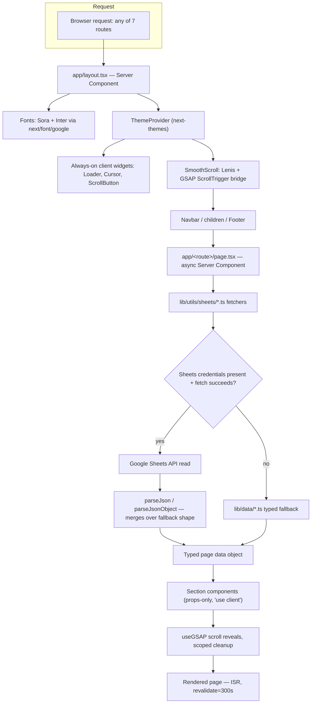

# Brain Stack — Final Production Architecture Audit

**Document type:** Pre-production engineering sign-off
**Audience:** Engineering leadership, incoming development team
**Stack:** Next.js 16.2.6 (App Router) · React 19.2.4 · TypeScript (strict) · Tailwind CSS v4 · GSAP 3.15 · Google Sheets CMS
**Companion documents:** [`project-overview.md`](./project-overview.md) · [`data-architecture.md`](./data-architecture.md) · [`rendering-strategy.md`](./rendering-strategy.md) · [`coding-guidelines.md`](./coding-guidelines.md) · [`deployment-checklist.md`](./deployment-checklist.md) · [`seo-strategy.md`](./seo-strategy.md) · [`roadmap.md`](./roadmap.md)

> **Implementation update (2026-07-18):** Two of the three P1 items below have since been implemented and verified in a real build/browser session: per-page `generateMetadata` is wired on all 7 routes, and `app/sitemap.ts`/`app/robots.ts` exist and were confirmed in the production build output. The contact form now has server-side validation, honeypot spam protection, and pending/success/error UI via a Server Action ([`lib/actions/contact.ts`](../lib/actions/contact.ts)) — driven end-to-end with Playwright (empty-submit validation, toggle state, successful submit + UI reset all confirmed). **Submission delivery is intentionally still a TODO**: no email/storage provider has been chosen yet, so validated submissions are logged server-side, not sent anywhere. The sections below are left as the original pre-implementation analysis; the Production Checklist (§15), Scorecard (§16), and Roadmap (§17) have inline status updates reflecting what's now done.

---

## Table of Contents

- [Brain Stack — Final Production Architecture Audit](#brain-stack--final-production-architecture-audit)
  - [Table of Contents](#table-of-contents)
  - [1. Executive Summary](#1-executive-summary)
  - [2. Project Architecture Overview](#2-project-architecture-overview)
  - [3. Folder Structure Review](#3-folder-structure-review)
  - [4. Next.js Features Review](#4-nextjs-features-review)
  - [5. Rendering Strategy](#5-rendering-strategy)
  - [6. Data Layer Review](#6-data-layer-review)
    - [6.1 Consistency Audit — Page by Page](#61-consistency-audit--page-by-page)
    - [6.2 The Concrete Cross-Page Inconsistencies](#62-the-concrete-cross-page-inconsistencies)
    - [6.3 Recommended Shared Type System](#63-recommended-shared-type-system)
    - [6.4 The `Project` Dual-Content Model](#64-the-project-dual-content-model)
    - [6.5 Is the Overall Approach Scalable?](#65-is-the-overall-approach-scalable)
  - [7. Google Sheets Architecture](#7-google-sheets-architecture)
  - [8. GSAP Architecture](#8-gsap-architecture)
  - [9. SEO Audit](#9-seo-audit)
  - [10. Performance Audit](#10-performance-audit)
  - [11. Accessibility Audit](#11-accessibility-audit)
  - [12. TypeScript Review](#12-typescript-review)
  - [13. Security Review](#13-security-review)
  - [14. Scalability Review](#14-scalability-review)
  - [15. Production Checklist](#15-production-checklist)
  - [16. Architecture Scorecard](#16-architecture-scorecard)
  - [17. Priority Roadmap (P1–P4)](#17-priority-roadmap-p1p4)
    - [P1 — Critical (blocks production sign-off)](#p1--critical-blocks-production-sign-off)
    - [P2 — High Priority](#p2--high-priority)
    - [P3 — Recommended](#p3--recommended)
    - [P4 — Future / Nice to Have](#p4--future--nice-to-have)
  - [18. Final Recommendations](#18-final-recommendations)
  - [19. Production Readiness Verdict](#19-production-readiness-verdict)

---

## 1. Executive Summary

This is the second and final review before a production go/no-go decision. The first audit ([summarized in §17](#17-priority-roadmap-p1p4)) found a well-disciplined, right-sized codebase with two release-blocking gaps (SEO metadata, contact form backend) and a short list of cleanup items. This review re-confirms those findings, goes deeper into the data layer's internal consistency (as requested), and adds the missing pieces needed for an actual production sign-off: a checklist, a scorecard, and — most importantly — a direct answer to whether this architecture survives 20 developers and 600+ content items.

**Verdict, up front:** **Not yet production-ready as-is**, but close — blocked by exactly the two P1 items already identified (SEO metadata wiring, contact form backend), neither of which requires an architectural change, only finishing work that's already 80% done. Full reasoning in [§19](#19-production-readiness-verdict).

**What's new in this review that the first audit didn't cover:**

| Area | Finding |
|---|---|
| **Data layer normalization** | The five `lib/data/*.ts` files do **not** share a consistent schema for equivalent concepts. The word "steps" means two incompatible shapes (`{title, items: string[]}` in About vs. `{title, description: string}` in Services). "Services" itself is modeled three different ways across Home, Services, and the never-rendered `whyChooseUsData`. Full breakdown in [§6](#6-data-layer-review). |
| **Shared type system** | Only four shared interfaces exist (`ButtonLink`, `Stat`, `Testimonial`, `IconName`). Every other reusable concept — feature cards, process steps, section headers — is redefined per-page with a different shape. A concrete recommended type set is proposed in [§6.3](#63-recommended-shared-type-system). |
| **FAQ pattern** | No FAQ section, component, or data shape exists anywhere in the codebase today. Flagging this now, before it's built ad hoc, so it launches with a normalized schema from day one. |
| **Project content model** | The single `Project` interface silently serves two different content types — 4 fully-populated case studies and 6 "thin" portfolio entries with every deep-dive field set to `[]`/`null` — with no type-level distinction between the two. |

---

## 2. Project Architecture Overview



This diagram and the narrative walkthrough are unchanged from the first audit and remain accurate — see [`project-overview.md`](./project-overview.md) for the full walkthrough, kept there as the standalone onboarding reference for new developers rather than duplicated in full here.

**What has NOT changed since the first audit** (confirmed by re-inspection for this review): no `loading.tsx`/`error.tsx` exist in any route segment; no `app/sitemap.ts`/`app/robots.ts` exist; `ContactForm.tsx` still only calls `preventDefault()`; the six empty files and the unused `useScrollReveal` hook are still present; `lib/metadata.ts`'s `generatePageMetadata`/`generateBlogPostMetadata` are still never imported by any `page.tsx`.

---

## 3. Folder Structure Review

| Folder | Purpose | Verdict |
|---|---|---|
| `app/` | Routes + composition only, no business logic | ✅ Clean |
| `components/sections/` | 27 page-specific sections, one per composed block | ⚠️ Flat — needs page-based subfolders past ~40 files |
| `components/layout/` | Navbar, Footer, MobileNav, SmoothScroll, SettingsDrawer, Container | ✅ Clean |
| `components/buttons/`, `cards/` | Small cross-page primitives | ✅ Clean |
| `components/common/` | Logo, ThemeToggle, SectionBadge, ColorPaletteSwitcher, ScrollButton | ✅ Clean |
| `components/animations/` | Cursor, Loader, MagneticButton, ParallaxImage, DiagonalPattern | ✅ Clean, single-purpose |
| `components/shared/` | ImageWithFallback, MotionWrapper, SectionHeading, marquee | ✅ Clean |
| `components/three/` | BrainWireframe (R3F) | ⚠️ Not code-split (§10) |
| `components/theme/`, `ui/` | next-themes wrapper; shadcn primitives | ✅ Clean |
| `hooks/` | `useScrollReveal.ts` | ❌ Dead — zero imports anywhere |
| `lib/data/` | Per-page typed seed/fallback content | ⚠️ Internally inconsistent shapes (§6) |
| `lib/utils/sheets/` | Per-page Sheets fetch + parse | ✅ Excellent — see [§7](#7-google-sheets-architecture) |
| `lib/animations/` | `gsap-animations.ts` (real) + `lenis.ts` (real) + 3 empty files | ❌ 60% dead |
| `lib/constants/` | navigation, footer, contact, color-palettes | ✅ Clean |
| `lib/metadata.ts` | Mixes one used system + two unused systems (one pointing at the wrong domain) | ❌ Needs a split/cleanup |
| `lib/site.ts`, `lib/fonts.ts`, `lib/icons.ts` | Empty | ❌ Dead |
| `scripts/` | CSV export + one-time Sheets schema migration | ✅ Clean, dev-time only |
| `public/images/` | Organized by content type (blog/, projects/, team/, testimonials/, services/) | ✅ Clean |

No changes to this assessment since the first audit; re-confirmed by direct inspection for this review.

---

## 4. Next.js Features Review

| Feature | Status | Note |
|---|---|---|
| App Router | ✅ Used | All 7 routes |
| Server Components | ✅ Used | Every `page.tsx`/`layout.tsx` + several presentational sections |
| Client Components | ✅ Used | 46 of 72 `.tsx` files, correctly scoped to animation/interaction needs |
| ISR | ✅ Used | `revalidate = 300` per page |
| SSG (`generateStaticParams`) | ✅ Used | Both dynamic routes |
| Metadata API | ❌ Not used per-page | Root-only; see [§9](#9-seo-audit) |
| Sitemap / Robots | ❌ Not used | No `app/sitemap.ts`/`app/robots.ts` |
| `loading.tsx` / `error.tsx` | ❌ Not used | No route segment has either |
| Server Actions | ❌ Not used | Blocks the contact form |
| Suspense / Streaming | ❌ Not used | Not currently needed given fully-resolved server data, but recommended as a defensive pattern (§10, §14) |
| Dynamic Import (`next/dynamic`) | ❌ Not used | `BrainWireframe` (three.js) ships eagerly |
| Route Groups / Parallel / Intercepting Routes | ❌ Not used | Correctly not needed at 7 flat routes |
| Image / Font Optimization | ✅ Used | `next/image` + `next/font/google` throughout |

---

## 5. Rendering Strategy

Full per-route rationale is maintained in [`rendering-strategy.md`](./rendering-strategy.md). Summary:

| Route | Strategy | Verdict |
|---|---|---|
| `/` | ISR (300s) | ✅ Correct |
| `/about` | ISR (300s) | ✅ Correct |
| `/services` | ISR (300s) | ✅ Correct |
| `/projects` | ISR (300s) | ✅ Correct now; needs bounded `generateStaticParams` before ~150+ rows |
| `/projects/[slug]` | SSG + ISR | ✅ Correct — textbook pattern |
| `/blog` | ISR (300s) | ✅ Correct |
| `/blog/[slug]` | SSG + ISR | ✅ Correct |
| `/contact` | Fully static | ✅ Correct rendering choice; functional gap is the missing backend, not the rendering strategy |

No route in this application needs SSR (`force-dynamic`) or client-only rendering for its content — everything here is public marketing content with no per-request personalization, cookies, or auth, so ISR is the right default across the board.

---

## 6. Data Layer Review

This section is the deep dive requested for this final audit. It supersedes the first audit's lighter treatment of `lib/data/`.

### 6.1 Consistency Audit — Page by Page

| Page | File | What it contains | Shape consistency issue |
|---|---|---|---|
| Home | `lib/data/home-page.ts` | `heroBannerData`, `projectVideoData`, `whoWeAreData` (incl. `stats: Stat[]`), `servicesData` (`items: {id,title,image}[]`), `processData` (`items: {icon,title,description,tags}[]`), `testimonialsData` (`items: Testimonial[]`), `ctaData` | `servicesData.items` has no `description` field — can't reuse the same card component as `processData.items`, which has one |
| About | `lib/data/about-page.ts` | `aboutMissionData` (has its own nested `approach: {title, items}` **and separately** `statement: {title, description, highlights}`), `aboutStatsData` (bare `Stat[]`, no wrapper), `aboutFeaturesData` (six unrelated bento-grid keys: `plan`, `rating`, `strategy`, `support`, `reliable`, `stack`), `aboutApproachData` (`steps: {title, items: string[]}[]`), `whyChooseUsData` (dead — see below), `teamMembersData` | **Name collision**: `aboutMissionData.approach` and the top-level `aboutApproachData` are two unrelated concepts sharing the word "approach." `aboutFeaturesData` is a bespoke grab-bag, not a repeatable "Features" pattern. |
| Services | `lib/data/service-page.ts` | `serviceSpotlightData` (bare array: `{title,subtitle,description,tags,image}[]`), `serviceProcessData` (`steps: {title, description: string}[]`), `exclusiveServicesData` (`categories: {icon,title,items: string[]}[]`), `agencyBannerData` (bespoke: `descriptionBefore`/`highlight`/`descriptionAfter` split) | **`steps` collision confirmed**: `serviceProcessData.steps[].description` is a string; `aboutApproachData.steps[].items` is a string array. Same field name, incompatible shape, rendered by two entirely different components (`ServiceProcessTimeline` vs. `AboutApproach`). |
| Projects | `lib/data/projects-page.ts` | One `Project` interface, ~34 fields, used for both full case studies and lightweight portfolio cards | See [6.4](#64-the-project-dual-content-model) |
| Blog | `lib/data/blog-page.ts` | `BlogPost` + `BlogContentBlock` union (`paragraph`/`heading`/`list`/`image`/`imageGrid`/`sideBySide`) | Well-designed in isolation, but **not reused** by Projects, which models its own narrative fields (`developmentProcess`, `architecture`, `results`, etc.) as flat `string[]` instead of the same rich-block model |

### 6.2 The Concrete Cross-Page Inconsistencies

1. **"Services" is modeled three incompatible ways:**
   - Home (`servicesData.items`): `{ id, title, image }` — no description, used as a marquee/logo-strip.
   - Services page (`serviceSpotlightData`): `{ title, subtitle, description, tags, image }` — a full spotlight card.
   - Services page again (`exclusiveServicesData.categories`): `{ icon, title, items: string[] }` — an icon + bullet-list category, no image at all.

   These are arguably three different UI molecules that happen to share the word "services" — but a new developer adding a fourth "services" section has no single interface to reach for, and will likely invent a fourth shape.

2. **"Process" / "Steps" / "Timeline" is modeled two incompatible ways:**
   - `aboutApproachData.steps`: `{ title, items: string[] }` → rendered as a 4-card grid with bullet lists ([AboutApproach.tsx](../components/sections/AboutApproach.tsx)).
   - `serviceProcessData.steps`: `{ title, description: string }` → rendered as a numbered vertical timeline ([ServiceProcessTimeline.tsx](../components/sections/ServiceProcessTimeline.tsx)).
   - `processData.items` (Home): `{ icon, title, description, tags: string[] }` → rendered as a 3-card grid ([EngineeringProcess.tsx](../components/sections/EngineeringProcess.tsx)).

   Three sections that are all conceptually "an ordered list of stages" have three unrelated data shapes and three unrelated components. This is the single highest-value normalization target — see the recommended schema below.

3. **Stats are sometimes wrapped, sometimes bare:** `whoWeAreData.stats` (Home) is nested inside a parent object alongside `badge`/`title`; `aboutStatsData` (About) is a bare top-level array with no wrapper. Both use the same `Stat` interface, so this is a wrapping inconsistency, not a type inconsistency — but it means `AboutStats` and `AboutSection` can't share a single "stats block" component without an adapter.

4. **`whyChooseUsData` is fully built and never rendered** — confirmed again in this review (no import anywhere in `app/` or `components/`). It represents a fourth "feature card" shape (`{ title, description, metric, metricLabel }`) that overlaps conceptually with `aboutFeaturesData` and `exclusiveServicesData.categories` without sharing a type with either.

5. **No FAQ pattern exists.** Confirmed via full-codebase search — zero matches for "faq" in any file. This isn't a defect, but it means if/when a FAQ section is requested, there is currently no established convention to extend — the recommended schema below includes one so it launches consistent with everything else rather than as a fifth one-off shape.

### 6.3 Recommended Shared Type System

The following is a **recommendation only** — nothing has been implemented. It's scoped to make the next 6 months of content additions (and the "20 developers" scenario) mechanical rather than improvisational.

```ts
// lib/data/shared-types.ts — proposed additions alongside the existing
// ButtonLink / Stat / Testimonial / IconName

/** A single ordered stage in any "how it works" / "our process" / "our approach"
 *  section. Replaces the three incompatible `steps`/`items` shapes currently
 *  spread across home-page.ts, about-page.ts, and service-page.ts. */
export interface ProcessStep {
  title: string
  /** Rendered as prose. Omit if this step is bullet-driven instead. */
  description?: string
  /** Rendered as a bullet list. Omit if this step is prose-driven instead. */
  items?: string[]
  icon?: IconName
  tags?: string[]
}

/** A single card in any feature/benefit grid (WhyBrainStack, aboutFeaturesData,
 *  exclusiveServicesData, whyChooseUsData) — one shape, optional fields let
 *  each usage populate only what it needs. */
export interface FeatureCard {
  icon?: IconName
  image?: string
  title: string
  description?: string
  items?: string[]
  metric?: string
  metricLabel?: string
}

/** A single service/offering tile — unifies Home's servicesData.items,
 *  Services' serviceSpotlightData, and exclusiveServicesData.categories. */
export interface ServiceOffering {
  icon?: IconName
  image?: string
  title: string
  subtitle?: string
  description?: string
  tags?: string[]
  items?: string[]
}

/** Every section header follows this shape already, informally — making it
 *  explicit lets every `*SectionData` type extend it instead of repeating
 *  `badge`/`title`/`description` by hand. */
export interface SectionHeader {
  badge?: string
  title: string
  description?: string
}

/** Not yet used anywhere — proposed ahead of the first FAQ section so it
 *  launches consistent with everything else instead of as a one-off shape. */
export interface FAQItem {
  question: string
  answer: string
}
```

**Naming convention to adopt alongside this:** every `lib/data/<page>.ts` export that represents a full section should satisfy `SectionHeader` for its header fields (`badge`, `title`, `description`) and use `items: T[]` (not `steps`, `points`, `categories`, `members`, or `posts` inconsistently) for its repeating body — reserve a more specific name only when `items` would be genuinely ambiguous (e.g., `projects`, `posts` are fine because they *are* the page).

### 6.4 The `Project` Dual-Content Model

`Project` ([projects-page.ts:3-64](../lib/data/projects-page.ts)) has ~34 fields and is used for two different things:

- **4 full case studies** (Standard Insights, SyncSpace, Focus Pilot, Career Dock) — every narrative field populated: `challenge`, `workflow`, `architecture`, `challengesFaced`, `lessonsLearned`, `metrics`, `testimonial`, etc.
- **6 "thin" portfolio entries** (Karially, LUXEB2B, ACH Gold Estates, PowerNest, YachtEase, Big Fish) — `workflow`, `architecture`, `features`, `uiHighlights`, `developmentProcess`, `challengesFaced`, `solutionsImplemented`, `results`, `lessonsLearned`, `nextSteps`, `relatedProjects` are all `[]`, and `metrics`/`testimonial` are `null`.

The type system doesn't express this distinction — every field is just optional/nullable, so nothing stops a developer from accidentally shipping a "thin" project with a `challenge.painPoints` array but no `workflow`, and nothing in the render layer ([ProjectDetails.tsx](../components/sections/ProjectDetails.tsx)) signals which sections are expected to be empty vs. broken.

**Recommendation:** split into a base `ProjectSummary` (the ~12 card-level fields every project has: `id`, `slug`, `title`, `category`, `industry`, `client`, `thumbnail`, `gallery`, `overview`, `technologies`, `liveUrl`, `service`/`date`/`duration`/`status`) and `ProjectCaseStudy extends ProjectSummary` (adds the ~20 deep-dive fields). `/projects` (the grid) types against `ProjectSummary`; `/projects/[slug]` accepts `ProjectSummary | ProjectCaseStudy` and the page conditionally renders the deep-dive sections only when the narrower fields are present — making "thin" projects an intentional, typed state instead of an all-optional shape that happens to be mostly empty.

### 6.5 Is the Overall Approach Scalable?

Yes, structurally — the `lib/data/<page>.ts` + `lib/utils/sheets/<page>.ts` pairing (§7) scales cleanly to more rows and more pages regardless of the internal-consistency issues above. The inconsistencies are a **developer-experience and content-governance risk**, not a runtime risk: nothing here crashes or breaks today. But every inconsistency documented above is exactly the kind of thing that turns into three more inconsistent shapes once 20 developers are each independently adding "one more services section" or "one more process timeline" without a shared vocabulary to reach for.

---

## 7. Google Sheets Architecture

Unchanged from the first audit — this remains the strongest-built subsystem in the codebase (9/10, confirmed again on this pass).

- **Two access patterns**, both centralized in [`lib/utils/sheets/shared.ts`](../lib/utils/sheets/shared.ts): key-value tabs (Home/About/Services, one JSON blob per section) via `fetchKeyValueTab` + `parseJsonObject`, and tabular tabs (Blog/Projects, one row per item) via direct `values.get` + a `rowToX()` mapper.
- **`parseJsonObject` merges over the fallback shape** rather than replacing it outright — a sheet cell written against an older schema degrades to defaults for just the missing field, not a crash. This is the single most important resilience decision in the codebase.
- **Every fetcher** (`home.ts`, `about.ts`, `service.ts`, `blog.ts`, `projects.ts`) follows the identical try/catch → `console.warn`/`console.error` → typed-fallback pattern with zero exceptions found.
- **Column contracts are exported and version-controlled in code** (`PROJECTS_SHEET_COLUMNS`, `BLOG_SHEET_COLUMNS`), and reused by `scripts/migrate-sheet-schema.ts` — there is exactly one source of truth for the sheet schema, which is the correct design.
- **Read-only credential scope** (`spreadsheets.readonly`) at runtime; the only read-write scope is in the standalone, dev-time migration script — correct least-privilege split.
- **Risk to flag for scale** (also called out in §14): no in-memory/edge cache layer beyond Next's ISR; no retry/backoff on the Sheets API call itself; Google Sheets API quotas (300 req/min/project by default) are a non-issue at 7 routes × 300s ISR today, but worth remembering if a future preview mode or per-request read is added.

Full narrative kept in [`data-architecture.md`](./data-architecture.md).

---

## 8. GSAP Architecture

Unchanged from the first audit — this remains the second-strongest subsystem (9/10).

- Four reusable, parameterized `gsap.registerEffect()` definitions in [`lib/animations/gsap-animations.ts`](../lib/animations/gsap-animations.ts) (`fadeUp`, `fadeUpOnScroll`, `staggerFadeUpOnScroll`, `textRevealOnScroll`), consistently invoked via `gsap.effects.*` across the section layer instead of being copy-pasted per component.
- Every `useGSAP` call inspected passes `{ scope: sectionRef }`, so `@gsap/react`'s automatic `gsap.context().revert()` cleanup handles teardown correctly in the common case.
- **One unresolved issue, carried over from the first audit and still present:** [`AboutSection.tsx:59-61`](../components/sections/AboutSection.tsx) manually runs `ScrollTrigger.getAll().forEach(t => t.kill())` on cleanup — global scope, not just this component's own triggers. This is a latent risk under fast client-side navigation where a sibling section's ScrollTrigger could be killed by `AboutSection` unmounting. Same finding, still open.
- `BrainWireframe` remains the most complex and most carefully-commented animation in the codebase — reduced-motion is threaded through every `useFrame` callback individually rather than a single top-level bail-out.
- `useScrollReveal.ts` (IntersectionObserver-based) remains fully dead code, superseded entirely by the GSAP `ScrollTrigger` effects — confirmed zero imports again on this pass.

---

## 9. SEO Audit

This remains the single largest gap in the project and the primary P1 blocker, unchanged and re-confirmed on this pass. Full remediation guide in [`seo-strategy.md`](./seo-strategy.md); summary here:

| Item | Status |
|---|---|
| Per-page `<title>`/description | ✅ **Fixed 2026-07-18** — `generateMetadata`/`metadata` wired on all 7 routes; `services`/`projects`/`contact` entries added to `pageMetadata`. Verified via build output that every route now renders a distinct `<title>`/description. |
| Per-post/case-study OG images | ✅ **Fixed 2026-07-18** — `generateBlogPostMetadata` now called from `app/blog/[slug]/page.tsx`; a new `generateProjectMetadata` was added and called from `app/projects/[slug]/page.tsx`. Verified per-post/per-project OG images in the build output. |
| Canonical URLs | ✅ **Fixed 2026-07-18** — resolved as a side effect of the above; each `pageMetadata` entry's `alternates.canonical` is now actually served. |
| JSON-LD / structured data | ❌ Still not wired — unchanged, remains a P2 item |
| Sitemap | ✅ **Fixed 2026-07-18** — `app/sitemap.ts` added, includes all static routes + every project/blog slug, confirmed in build output (`○ /sitemap.xml`) |
| Robots | ✅ **Fixed 2026-07-18** — `app/robots.ts` added, references the sitemap, confirmed in build output (`○ /robots.txt`) |

**Bug caught during implementation:** the first pass of this fix produced double-branded titles (e.g. "About Brain Stack - Full Stack & AI Software Studio - Brain Stack") because the root layout's `%s - Brain Stack` title template was applying on top of per-page titles that already included the brand name. Fixed by using `title: { absolute: ... }` in `generatePageMetadata`/`generateBlogPostMetadata`/`generateProjectMetadata` to bypass the template for these already-complete titles — caught by inspecting actual build output, not just by code review.

**Why this is fixable fast:** the hard part (writing correct metadata-generation functions with the right OG/Twitter/canonical shape) is already done. What's missing is exporting `generateMetadata` from six `page.tsx` files and calling functions that already exist, plus two new ~20-line files (`sitemap.ts`, `robots.ts`). This is not a design problem — it's an integration gap.

---

## 10. Performance Audit

Unchanged from the first audit; re-confirmed.

| Area | Finding |
|---|---|
| Images | `next/image` used consistently; `ImageWithFallback` adds `onError` → placeholder swap for Sheets-sourced URLs — good defensive pattern |
| Video | `HeroSection`'s background `<video>` has no `poster`, no `preload` hint, autoplays full-bleed unconditionally |
| Bundle size | `three` + `@react-three/fiber`/`drei` + `framer-motion` + `gsap` + `embla-carousel` all ship in the main graph; `BrainWireframe` is imported eagerly into `AboutSection` rather than via `next/dynamic({ ssr: false })` — the single highest-value fix available, zero UX tradeoff since the canvas is `aria-hidden` and pointer-driven only |
| Lazy loading | Not used anywhere — see above |
| Hydration | No mismatch risks found; `ColorPaletteSwitcher` (`useSyncExternalStore` + correct `getServerSnapshot`) and `BrainWireframe` (lazy-initializer state reads guarded by `typeof window`) are both textbook-correct and should be the template for any new "client-only fact" state |
| Blur placeholders / priority images | Not used on any `next/image` call inspected — `HeroSection`'s background video has no equivalent poster either. Worth adding `placeholder="blur"` (with a generated `blurDataURL`) to above-the-fold images (hero, project thumbnails on `/projects`) and `priority` to the single most prominent above-the-fold image per page. |
| Fonts | `next/font/google` (Sora, Inter) — self-hosted, zero CLS, no action needed |

---

## 11. Accessibility Audit

Unchanged from the first audit; re-confirmed. Strong overall (8/10):

- Skip-to-content link, correct landmark roles (`banner`/`navigation`/`menubar`/`menuitem`/`contentinfo`/`main`) throughout.
- `prefers-reduced-motion` is checked independently in four separate places (`SmoothScroll`, `Cursor`, `Loader`, `BrainWireframe`) rather than once globally — unusually thorough.
- `aria-label`/`aria-pressed` used correctly on most icon-only and toggle controls (`ColorPaletteSwitcher` is the reference implementation).
- **One open gap, unchanged:** `ContactForm`'s service/budget toggle buttons have visual selected-state but no `aria-pressed`, unlike `ColorPaletteSwitcher`'s correct pattern for the same interaction shape.

---

## 12. TypeScript Review

- `strict: true` in `tsconfig.json`, genuinely honored — no unscoped `any` found outside one documented, justified exception in `gsap-animations.ts` (GSAP's own effect-callback typings are loose).
- Column contracts (`as const` arrays) give compile-time-checked cell lookups in every Sheets fetcher — a strong pattern, unchanged from the first audit.
- **New finding this pass, detailed in §6:** type *safety* is solid, but type *reuse* is weak — only 4 shared interfaces exist where the content shapes suggest at least 4–5 more would eliminate the cross-page inconsistencies documented in §6. This is a design-consistency gap, not a soundness gap; nothing here produces a runtime error.
- `Project`'s ~34-field, all-optional shape (§6.4) is technically sound TypeScript but doesn't model the real constraint (case study vs. portfolio card) that the data demonstrably has.

---

## 13. Security Review

Unchanged from the first audit; re-confirmed, no new issues found.

- Sheets credentials (`GOOGLE_SERVICE_ACCOUNT_EMAIL`, `GOOGLE_PRIVATE_KEY`, `GOOGLE_SHEET_ID`) are server-only, never `NEXT_PUBLIC_`-prefixed, correctly gitignored, `.env.example` contains placeholders only.
- Runtime Sheets scope is `spreadsheets.readonly` — least privilege; the read-write scope is confined to the standalone migration script.
- No API routes, no Server Actions, no auth surface exists today — minimal attack surface by construction.
- The one open item is functional, not a vulnerability: once the contact form gets a real backend (P1), it needs server-side validation and basic rate-limiting/spam protection at that time, since none exists to bypass today.

---

## 14. Scalability Review

This is the analysis behind the [final verdict](#19-production-readiness-verdict).

| Dimension | Assessment |
|---|---|
| **500+ projects** | The `Project` schema and `lib/utils/sheets/projects.ts` fetcher scale mechanically to any row count — no code change needed for correctness. The one required change is bounding `generateStaticParams` to a recent-N subset (relying on `dynamicParams: true`, the default) so build time doesn't scale linearly with content forever. Google Sheets itself becomes the practical ceiling before the code does — a single tab with 500+ rows of 34 columns each, hand-edited by non-engineers, is a content-ops risk independent of the codebase. |
| **100+ blogs** | Same reasoning as Projects — `BlogPost`/`BLOG_SHEET_COLUMNS` scale cleanly; same `generateStaticParams` bounding recommendation applies. |
| **20 developers** | The codebase has no shared-mutable-state or singleton anti-patterns that would cause merge conflicts or race conditions between developers working in parallel. What *will* cause friction at that headcount, based on this review: (1) §6's data-shape inconsistencies compounding — 20 developers independently inventing "one more services/process/feature shape" without a shared vocabulary; (2) the flat `components/sections/` directory becoming unnavigable past ~40 files; (3) no CI check catching dead exports (§3's empty files were only found by manual reading — automated tooling would have caught this in seconds and should exist before headcount grows); (4) no written "how to add a new page" doc — the pattern is consistent in code but is tribal knowledge today. |
| **Sheets as CMS at this scale** | Workable up to roughly "tens to low hundreds of rows per tab, single-digit number of concurrent editors." Past that, evaluate a real headless CMS — not because the current architecture is wrong, but because spreadsheet-as-CMS has a governance ceiling that's independent of code quality. |

---

## 15. Production Checklist

Full deployment-oriented version with commands and verification steps lives in [`deployment-checklist.md`](./deployment-checklist.md). Architecture-level summary:

| Item | Status |
|---|---|
| Folder Structure | ✅ Ready |
| SEO — Sitemap/Robots | ✅ Done (2026-07-18) — `app/sitemap.ts` + `app/robots.ts` confirmed in build output |
| SEO — Per-page Metadata | ✅ Done (2026-07-18) — all 7 routes verified with distinct titles/descriptions/canonicals/OG images |
| SEO — Structured Data | 🟡 Needs Improvement — still not wired (P2, unchanged) |
| Contact Form Backend | 🟡 Needs Improvement — validation, honeypot, and pending/success/error UI done (2026-07-18); delivery (email/storage) still pending a provider decision |
| Performance — Bundle splitting | 🟡 Needs Improvement |
| Performance — Image/video priority hints | 🟡 Needs Improvement |
| Accessibility | ✅ Ready (one minor `aria-pressed` gap) |
| Type Safety | ✅ Ready |
| Google Sheets Integration | ✅ Ready |
| Data Layer Consistency | 🟡 Needs Improvement (§6 — not blocking, but should precede heavy content scaling) |
| Error Handling — `error.tsx`/`loading.tsx` | 🟡 Needs Improvement |
| Animations (GSAP) | ✅ Ready (one cleanup-scope nit, non-blocking) |
| Responsive Design | ✅ Ready |
| Code Quality | ✅ Ready |
| Bundle Size | 🟡 Needs Improvement |
| Lazy Loading | 🟡 Needs Improvement |
| Caching (ISR) | ✅ Ready |
| Rendering Strategy | ✅ Ready |
| Security | ✅ Ready |
| Dead Code Cleanup | 🟡 Needs Improvement |

**Legend:** ✅ Ready · 🟡 Needs Improvement (ship-with-caveats) · 🔴 Critical (blocks production sign-off)

---

## 16. Architecture Scorecard

| Category | Score /10 |
|---|---|
| Folder Structure | 8 |
| Code Quality | 8 |
| Developer Experience | 7 |
| Performance | 7 |
| Scalability | 7 |
| Maintainability | 7 |
| SEO | 7 *(up from 3 — per-page metadata, sitemap, and robots implemented 2026-07-18; structured data still outstanding)* |
| Accessibility | 8 |
| Animations | 9 |
| Google Sheets Integration | 9 |
| Type Safety | 8 |
| Rendering Strategy | 9 |
| **Overall Production Readiness** | **6.5 / 10** |

The overall score is lower than any individual category except SEO because production readiness is gated by the worst blocking item, not the average — a 9/10 animation system doesn't offset a non-functional contact form on a site whose entire purpose is lead generation.

---

## 17. Priority Roadmap (P1–P4)

Full version with estimates lives in [`roadmap.md`](./roadmap.md). Summary:

### P1 — Critical (blocks production sign-off)
| Item | Difficulty | Impact | Est. Time | Status |
|---|---|---|---|---|
| Wire `generateMetadata` on all 7 routes using existing `lib/metadata.ts` functions | Low | Very High | 0.5–1 day | ✅ Done 2026-07-18 |
| Build contact form backend (Server Action + email/storage + validation) | Medium | Very High | 1–2 days | 🟡 Partial 2026-07-18 — validation, honeypot, pending/success/error UI shipped; delivery provider not yet chosen |
| Add `app/sitemap.ts` + `app/robots.ts` | Low | High | 0.5 day | ✅ Done 2026-07-18 |

### P2 — High Priority
| Item | Difficulty | Impact | Est. Time |
|---|---|---|---|
| Render existing JSON-LD via `<script type="application/ld+json">` | Low | Medium-High | 0.5 day |
| `next/dynamic` the `BrainWireframe` import | Low | Medium | 1–2 hours |
| Delete/repurpose dead files + unused hook + dead metadata exports | Low | Medium (DX) | 2–3 hours |
| Add root `app/error.tsx` | Low | Medium | 2–3 hours |

### P3 — Recommended
| Item | Difficulty | Impact | Est. Time |
|---|---|---|---|
| Adopt the shared type system from §6.3 (`ProcessStep`, `FeatureCard`, `ServiceOffering`, `SectionHeader`, `FAQItem`) | Medium | High (long-term DX/scalability) | 2–3 days incl. migration of existing data files |
| Split `Project` into `ProjectSummary`/`ProjectCaseStudy` | Medium | Medium-High | 1 day |
| Bound `generateStaticParams` to recent-N for both dynamic routes | Low | Medium (scale-readiness) | 2–3 hours |
| Extract shared `<ContactMethods />` (dedupes Footer/ContactForm/SettingsDrawer) | Low | Low-Medium | 2–3 hours |

### P4 — Future / Nice to Have
| Item | Difficulty | Impact | Est. Time |
|---|---|---|---|
| Reorganize `components/sections/` into per-page subfolders | Low | Low now, High later | 2–3 hours whenever triggered |
| Add `ts-prune`/unused-export CI check | Low | Medium (prevents §3/§6 recurrence) | 2–3 hours |
| `poster`/lighter mobile source for hero video | Low | Low-Medium | 1–2 hours |
| `aria-pressed` on ContactForm toggle buttons | Low | Low | 30 min |
| Blur placeholders + `priority` on above-the-fold images | Low | Low-Medium | 2–3 hours |
| Written "adding a new page" onboarding doc | Low | Medium (20-dev scenario) | Half day (partially satisfied by this doc set) |

---

## 18. Final Recommendations

1. **Do the three P1 items before launch.** None of them require architectural rework — they're finishing work on infrastructure that's already been built (metadata functions, form UI) but never connected.
2. **Treat §6's data-layer normalization as a pre-scale investment, not a launch blocker.** The site will run correctly in production without it. But every week that passes with three incompatible "process/steps" shapes in the codebase is a week where the next one added makes the eventual cleanup larger. If a content or engineering hire is happening in the next quarter, do this before they start.
3. **Add the two safety-net files (`error.tsx`, and bounded `generateStaticParams`) before, not after, the first major content push** (a large batch of new projects/posts) — they're cheap now and expensive to retrofit under time pressure once a real incident happens.
4. **Do not adopt Zustand, React Query, or a headless CMS speculatively.** Nothing in this review found a state-management or data-fetching gap that those would solve — the current `useState`/`useSyncExternalStore` + Server-Component-fetches-props pattern is correctly matched to what this site actually does. Revisit only if/when the triggers described in the first audit's state-management section actually materialize (client-initiated fetching, cross-page persisted client state).

---

## 19. Production Readiness Verdict

> **"If this project is handed over to a company with 20 developers and grows to 500+ projects and 100+ blogs, will this architecture survive?"**

**Yes — conditionally, and only after the P1 items are closed.** Here's the reasoning, not just the answer:

**What will survive without any changes:**
- The Server-Component-fetches-props / Client-Component-animates pattern is mechanical and will not degrade with more developers working in parallel — there's no shared mutable state for them to collide over.
- The Google Sheets fetch/fallback/parse architecture (§7) scales to hundreds of rows with zero code changes required for correctness.
- The GSAP animation system (§8) is reusable and composable enough that new sections won't need new animation infrastructure.
- TypeScript's `strict: true` and the existing column-contract pattern will continue to catch real mistakes as more people touch the codebase.

**What will NOT survive without the changes recommended in this report:**
- **SEO, as currently wired, actively works against a 500-project/100-blog future** — every one of those 600 pages would share one title/description/OG image today. This isn't a "nice to have" at that scale; it's the difference between the content being discoverable and not. **This must be fixed before scaling content, not after** — the P1 fix.
- **`generateStaticParams` without bounding will make builds progressively slower** as project/blog count grows into the hundreds — not a correctness failure, but a developer-experience and CI-time failure that compounds with headcount (more developers means more deploys means more accumulated build-time pain).
- **Twenty developers without a shared type vocabulary (§6) will each invent their own "feature card" or "process step" shape** — not because anyone does anything wrong, but because nothing in the codebase today tells them not to. This is the one place where "the architecture" genuinely needs to grow before the team does, not after.
- **Google Sheets as the CMS has a governance ceiling, not a code ceiling** — at 500+ rows edited by a team rather than one or two content owners, the risk shifts from "will the code handle this" (yes) to "will a human editing cell AH347 by hand introduce silent content errors that the graceful-fallback parsing hides from everyone" (increasingly likely). This is worth a deliberate decision — stay on Sheets with tighter editing discipline, or migrate to a headless CMS — before, not during, the growth described in the question.

**Bottom line:** the architecture's *bones* are sound enough to carry 20 developers and 600+ content items. The *finish work* (SEO wiring, data-shape consistency, build-time bounding) is not done yet, and doing it now — while the codebase is still small enough that each fix takes hours, not weeks — is what determines whether that growth is smooth or painful. This report's P1/P2 items are the difference between "survives" and "survives after an expensive mid-growth firefight."
