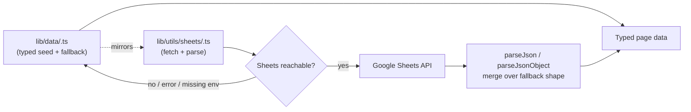

# Brain Stack — Data Architecture

**Scope:** Google Sheets integration, fallback data structure, and the normalized schema recommended for future content types. See [`architecture-audit.md` §6–7](./architecture-audit.md#6-data-layer-review) for the audit findings this document expands on.

---

## 1. The two-layer model

Every page's content exists in two places, kept in sync by convention rather than by a single source of truth at runtime:



- **`lib/data/<page>.ts`** — the ground truth for shape (every interface is defined here) and the fallback content used whenever Sheets is unreachable, misconfigured, or returns malformed data.
- **`lib/utils/sheets/<page>.ts`** — reads the live Google Sheet and parses it into the *same* shape, cell by cell.

Both exist for every page: `home`, `about`, `service`, `projects`, `blog`.

## 2. Two Sheets access patterns

| Pattern | Used by | Mechanism |
|---|---|---|
| **Key-value tab** | Home, About, Services | 2-column sheet (`sectionName \| JSON blob`), read via `fetchKeyValueTab(tab)` then `parseJsonObject(cell, fallback)` per section |
| **Tabular tab** | Blog, Projects | One row per item, fixed column order, read via `spreadsheets.values.get()` then a `rowToX(row)` mapper |

Both share `lib/utils/sheets/shared.ts`:

```ts
// Simplified — see the real file for full implementation
export function parseJson<T>(value: string | undefined, fallback: T): T
export function parseJsonObject<T extends object>(value: string | undefined, fallback: T): T
export async function fetchKeyValueTab(tab: string): Promise<Record<string, string> | null>
```

**The one design decision worth calling out explicitly:** `parseJsonObject` **merges** the parsed cell over the fallback object (`{ ...fallback, ...parsed }`) rather than replacing it. If a sheet cell is written against an older schema — missing a since-renamed field — the result degrades to that one field's default instead of leaving it `undefined` and crashing whatever component reads it. This is why a content editor typo can't take the site down.

## 3. Error handling & fallback strategy

Every fetcher in `lib/utils/sheets/` follows this exact sequence, with zero deviation across `home.ts`, `about.ts`, `service.ts`, `blog.ts`, `projects.ts`:

```ts
export async function get<X>Data() {
  try {
    const client = getSheetsClient() // null if env vars missing
    if (!client) {
      console.warn("[sheets] ... — using local <x>-page data.")
      return FALLBACK
    }
    // fetch + parse
    return parsed
  } catch (error) {
    console.error(`[sheets] Failed to fetch "<tab>" tab:`, error)
    return FALLBACK
  }
}
```

**Recovery strategy:** always the typed local fallback, never a thrown error, never a partial/undefined result. The tradeoff (see `architecture-audit.md` §16) is that failures are silent to the end user and to the content editor — the only signal is a server log line. There is currently no alerting on these warnings/errors; if Sheets access breaks (revoked service account, quota, renamed tab), the site keeps working on stale/fallback content indefinitely with nobody notified.

## 4. Current schema inconsistencies (detailed)

This is the deep-dive requested for the final audit — full context in `architecture-audit.md` §6.1–6.4. Summarized as a lookup table:

| Concept | Home | About | Services | Projects | Blog |
|---|---|---|---|---|---|
| Section header | `{ badge, title, description }` (varies which fields present) | Same pattern, inconsistent presence | Same pattern | `{ badge, title, description }` on the wrapper | `{ badge, title }` |
| "Steps/Process" | `processData.items: {icon,title,description,tags}[]` | `aboutApproachData.steps: {title, items: string[]}[]` | `serviceProcessData.steps: {title, description}[]` | — | — |
| "Features/Cards" | — | `aboutFeaturesData` (bespoke bento bag) + unused `whyChooseUsData.points` | `exclusiveServicesData.categories: {icon,title,items}[]` | — | — |
| "Services" | `servicesData.items: {id,title,image}[]` | — | `serviceSpotlightData: {title,subtitle,description,tags,image}[]` (bare array) | — | — |
| Stats | `whoWeAreData.stats: Stat[]` (wrapped in parent) | `aboutStatsData: Stat[]` (bare, top-level) | — | — | — |
| Testimonials | `testimonialsData.items: Testimonial[]` | — | — | `testimonial: Testimonial \| null` (per-project) | — |
| Buttons | `ButtonLink` used consistently | Mostly consistent | Consistent | `liveUrl: string \| null` (not a `ButtonLink`) | — |
| Rich content | — | — | — | Flat `string[]` for narrative fields | `BlogContentBlock` union (paragraph/heading/list/image/imageGrid/sideBySide) |
| FAQ | — | — | — | — | — (doesn't exist anywhere) |

**Read this table as:** the same conceptual "molecule" (a process timeline, a feature grid, a services list) is implemented as a different, incompatible shape almost every time it recurs. None of this breaks anything today — it's a consistency and reuse gap, not a bug.

## 5. Recommended normalized schema

Proposed additions to `lib/data/shared-types.ts` — **not implemented, recommendation only**:

```ts
/** Any ordered "how it works" / "our approach" / "our process" stage.
 *  Replaces the three incompatible `steps` shapes in home/about/service pages. */
export interface ProcessStep {
  title: string
  description?: string   // prose-driven step
  items?: string[]        // bullet-driven step
  icon?: IconName
  tags?: string[]
}

/** Any feature/benefit card — unifies aboutFeaturesData, whyChooseUsData.points,
 *  exclusiveServicesData.categories into one shape. */
export interface FeatureCard {
  icon?: IconName
  image?: string
  title: string
  description?: string
  items?: string[]
  metric?: string
  metricLabel?: string
}

/** Any service/offering tile — unifies servicesData.items and serviceSpotlightData. */
export interface ServiceOffering {
  icon?: IconName
  image?: string
  title: string
  subtitle?: string
  description?: string
  tags?: string[]
  items?: string[]
}

/** Standard section header — every *SectionData type's header fields should
 *  satisfy this instead of redeclaring badge/title/description ad hoc. */
export interface SectionHeader {
  badge?: string
  title: string
  description?: string
}

/** Proposed ahead of the first FAQ section, so it launches consistent with
 *  everything else instead of as a new one-off shape. */
export interface FAQItem {
  question: string
  answer: string
}
```

**Adoption path (P3, not urgent):** introduce these types alongside the existing ones (no breaking change), then migrate one page's data file at a time to use them, starting with whichever page next needs a new section added — that's the point where the inconsistency would otherwise be compounded, so it's the cheapest moment to fix it.

## 6. The `Project` dual-content-model issue

`Project` currently has ~34 fields serving two different real content types:

- **Full case studies** (4 of 10 current projects): every narrative field populated.
- **Portfolio cards** (6 of 10 current projects): every deep-dive field is `[]`/`null`.

**Recommended split:**

```ts
interface ProjectSummary {
  id: string; slug: string; title: string; shortTitle: string
  category: string; industry: string; client: string
  service: string | null; date: string | null; duration: string | null; status: string | null
  liveUrl: string | null
  thumbnail: string; heroImage: string; gallery: string[]
  overview: string
  technologies: string[]; tools: string[]
}

interface ProjectCaseStudy extends ProjectSummary {
  challenge: { title: string | null; description: string; painPoints: string[]; businessImpact: string[] }
  goals: string[]
  solution: { title: string; description: string; highlights: string[] }
  workflow: { title: string; description: string }[]
  architecture: string[]; features: string[]; uiHighlights: string[]
  developmentProcess: string[]; challengesFaced: string[]; solutionsImplemented: string[]; results: string[]
  metrics: { performance: string; seo: string; accessibility: string; bestPractices: string }
  testimonial: Testimonial
  lessonsLearned: string[]; nextSteps: string[]; relatedProjects: string[]
}

type Project = ProjectSummary | ProjectCaseStudy
```

`/projects` (grid) types against `ProjectSummary`. `/projects/[slug]` accepts `Project` and renders the deep-dive sections conditionally based on which shape it received — making "thin" projects an intentional, typed state instead of an accident of all-optional fields.

## 7. Scaling ceiling

Structurally, this architecture scales to hundreds of rows with no code changes. The real ceiling is **content governance**, not code: Google Sheets as a hand-edited CMS by more than a couple of people, at more than roughly 100–150 rows per tab, becomes error-prone in ways the graceful-fallback parsing hides rather than surfaces. See `architecture-audit.md` §14 for the full scalability analysis.
