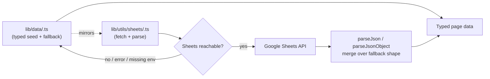

# Brain Stack — Data Architecture

**Scope:** Google Sheets integration, fallback data structure, and the normalized schema across `lib/data/`. See [`architecture-audit.md` §6–7](./architecture-audit.md#6-data-layer-review) for the audit findings this document originally expanded on.

> **Implementation update (2026-07-18):** Sections 4–6 below described a set of *recommended* fixes. All of them have since been implemented and verified (typecheck, lint, full production build, and a browser pass over `/about`, `/services`, and both a case-study and a portfolio-only project page). The sections are kept in their original "here's the problem, here's the fix" form since that's still the right way to understand *why* the current shapes look the way they do — status notes are added inline.
>
> **If a Google Sheet is already populated with real content:** the JSON-key renames in §4/§5 (`approach`→`pillars`, `steps`→`items`, `categories`→`items`, `points`→`items`) only affect the **About** and **Services** tabs' key-value JSON cells (`mission`, `approach`, `process`, `exclusiveServices`, `whyChooseUs`) — update those cells' JSON keys to match, or the site will silently fall back to default copy for the renamed field (see §1's merge-over-fallback behavior). **No column headers were renamed** on the tabular **Blog** or **Projects** tabs — those sheets need no changes at all.

---

## 1. The two-layer model

Every page's content exists in two places, kept in sync by convention rather than by a single source of truth at runtime:



- **`lib/data/<page>.ts`** — the ground truth for shape (every interface is defined here) and the fallback content used whenever Sheets is unreachable, misconfigured, or returns malformed data.
- **`lib/utils/sheets/<page>.ts`** — reads the live Google Sheet and parses it into the *same* shape, cell by cell.

Both exist for every page: `home`, `about`, `service`, `projects`, `blog`.

## 2. Two Sheets access patterns

| Pattern | Used by | Mechanism |
|---|---|---|
| **Key-value tab** | Home, About, Services | 2-column sheet (`sectionName \| JSON blob`), read via `fetchKeyValueTab(tab)` then `parseJsonObject(cell, fallback)` per section |
| **Tabular tab** | Blog, Projects | One row per item, fixed column order, read via `spreadsheets.values.get()` then a `rowToX(row)` mapper |

Both share `lib/utils/sheets/shared.ts`:

```ts
// Simplified — see the real file for full implementation
export function parseJson<T>(value: string | undefined, fallback: T): T
export function parseJsonObject<T extends object>(value: string | undefined, fallback: T): T
export async function fetchKeyValueTab(tab: string): Promise<Record<string, string> | null>
```

**The one design decision worth calling out explicitly:** `parseJsonObject` **merges** the parsed cell over the fallback object (`{ ...fallback, ...parsed }`) rather than replacing it. If a sheet cell is written against an older schema — missing a since-renamed field — the result degrades to that one field's default instead of leaving it `undefined` and crashing whatever component reads it. This is why a content editor typo can't take the site down.

## 3. Error handling & fallback strategy

Every fetcher in `lib/utils/sheets/` follows this exact sequence, with zero deviation across `home.ts`, `about.ts`, `service.ts`, `blog.ts`, `projects.ts`:

```ts
export async function get<X>Data() {
  try {
    const client = getSheetsClient() // null if env vars missing
    if (!client) {
      console.warn("[sheets] ... — using local <x>-page data.")
      return FALLBACK
    }
    // fetch + parse
    return parsed
  } catch (error) {
    console.error(`[sheets] Failed to fetch "<tab>" tab:`, error)
    return FALLBACK
  }
}
```

**Recovery strategy:** always the typed local fallback, never a thrown error, never a partial/undefined result. The tradeoff (see `architecture-audit.md` §16) is that failures are silent to the end user and to the content editor — the only signal is a server log line. There is currently no alerting on these warnings/errors; if Sheets access breaks (revoked service account, quota, renamed tab), the site keeps working on stale/fallback content indefinitely with nobody notified.

## 4. Schema inconsistencies — before/after

This was the deep-dive from the final audit — full context in `architecture-audit.md` §6.1–6.4. **All renames below are implemented** (2026-07-18):

| Concept | Home | About | Services | Projects | Blog |
|---|---|---|---|---|---|
| Section header | `{ badge, title, description }` | Same pattern | Same pattern | `{ badge, title, description }` on the wrapper | `{ badge, title }` |
| "Steps/Process" | `processData.items: ProcessStep[]` | `aboutApproachData.items: ProcessStep[]` ~~steps~~ | `serviceProcessData.items: ProcessStep[]` ~~steps~~ | — | — |
| "Features/Cards" | — | `aboutFeaturesData` (bespoke bento layout — see note below) + `whyChooseUsData.items: FeatureCard[]` ~~points~~ (still unused, but now schema-consistent) | `exclusiveServicesData.items: ServiceOffering[]` ~~categories~~ | — | — |
| "Services" | `servicesData.items: ServiceOffering[]` | — | `serviceSpotlightData: ServiceOffering[]` (bare array, unchanged shape — see note) | — | — |
| Name collision | — | `aboutMissionData.pillars` ~~approach~~ (no longer collides with the page-level `aboutApproachData`) | — | — | — |
| Stats | `whoWeAreData.stats: Stat[]` (wrapped in parent) | `aboutStatsData: Stat[]` (bare, top-level) | — | — | — |
| Testimonials | `testimonialsData.items: Testimonial[]` | — | — | `CaseStudyProject.testimonial: Testimonial` (only on case studies — see §6) | — |
| Buttons | `ButtonLink` used consistently | Mostly consistent | Consistent | `liveUrl: string \| null` (not a `ButtonLink` — a raw external URL, not an internal nav action, so left as-is) | — |
| Rich content | — | — | — | Flat `string[]` for narrative fields (unchanged — see note) | `BlogContentBlock` union (paragraph/heading/list/image/imageGrid/sideBySide) |
| FAQ | — | — | — | — | `FAQItem` type added to `shared-types.ts`, unused — no FAQ section exists yet |

**What was intentionally left alone:**
- `aboutFeaturesData` — a fixed bento-grid layout (plan/rating/strategy/support/reliable/stack), not a repeating list. Forcing it into `FeatureCard[]` would have meant restructuring `WhyBrainStack.tsx`'s actual grid layout, which was out of scope ("no UI changes").
- `serviceSpotlightData`'s bare-array wrapping and the flat `string[]` narrative fields on `Project` — reshaping either would touch the Sheets column contract (see the note at the top of this document) or require deeper UI changes than a data-layer pass should make.
- The stats wrapping inconsistency (`whoWeAreData.stats` wrapped vs. `aboutStatsData` bare) — low risk, low reward; left as a known, documented remaining inconsistency.

## 5. The shared type system

Implemented in `lib/data/shared-types.ts` (2026-07-18), alongside the pre-existing `ButtonLink`/`Stat`/`Testimonial`/`IconName`:

```ts
/** Any ordered "how it works" / "our approach" / "our process" stage.
 *  Replaces what were three incompatible `steps` shapes in home/about/service pages. */
export interface ProcessStep {
  title: string
  description?: string   // prose-driven step
  items?: string[]        // bullet-driven step
  icon?: IconName
  tags?: string[]
}

/** Any feature/benefit card — unifies whyChooseUsData's items with the general
 *  concept; aboutFeaturesData stays a bespoke bento layout (see §4 note). */
export interface FeatureCard {
  icon?: IconName
  image?: string
  title: string
  description?: string
  items?: string[]
  metric?: string
  metricLabel?: string
}

/** Any service/offering tile — unifies servicesData.items, serviceSpotlightData,
 *  and exclusiveServicesData.items into one shape. */
export interface ServiceOffering {
  /** Display index (e.g. "01"), not a stable identity. */
  id?: string
  icon?: IconName
  image?: string
  title: string
  subtitle?: string
  description?: string
  tags?: string[]
  items?: string[]
}

/** Standard section header — documents the badge/title/description pattern
 *  every section already followed informally. */
export interface SectionHeader {
  badge?: string
  title: string
  description?: string
}

/** Ahead of the first FAQ section, so it launches consistent with everything
 *  else instead of as a new one-off shape. Not consumed anywhere yet — no
 *  FAQ section exists in the app. */
export interface FAQItem {
  question: string
  answer: string
}
```

Applied via `satisfies ProcessStep[]` / `satisfies ServiceOffering[]` / `satisfies FeatureCard[]` on the relevant arrays in `home-page.ts`, `about-page.ts`, and `service-page.ts` — this both documents intent at the definition site and gives a compile error if a future edit drifts from the shared shape.

**Naming convention now in effect:** every section's repeating list uses `items: T[]` (not `steps`, `points`, or `categories`) unless the name is unambiguous on its own (`projects`, `posts`). New sections should follow the same pattern — check `shared-types.ts` before inventing a new inline shape.

## 6. The `Project` model — implemented split

`Project` was a single ~34-field interface serving two real content types — 4 full case studies with every narrative field populated, and 6 portfolio cards with every deep-dive field as `[]`/`null`. **Implemented (2026-07-18)** in `lib/data/projects-page.ts`:

```ts
interface BaseProject {
  id: string; slug: string; title: string; shortTitle: string
  category: string; industry: string; client: string
  service: string | null; date: string | null; duration: string | null; status: string | null
  liveUrl: string | null
  thumbnail: string; heroImage: string; gallery: string[]
  overview: string
  technologies: string[]; tools: string[]
  // Present on every project, including "thin" portfolio entries — even those
  // carry a real challenge/solution summary, just not the deeper narrative
  // fields below.
  challenge: ProjectChallenge
  solution: ProjectSolution
}

interface PortfolioProject extends BaseProject {
  kind: "portfolio"
}

interface CaseStudyProject extends BaseProject {
  kind: "case-study"
  goals: string[]
  workflow: ProjectWorkflowStep[]
  architecture: string[]; features: string[]; uiHighlights: string[]
  developmentProcess: string[]; challengesFaced: string[]; solutionsImplemented: string[]; results: string[]
  metrics: ProjectMetrics       // no longer nullable — only exists when kind is "case-study"
  testimonial: Testimonial      // no longer nullable, same reason
  lessonsLearned: string[]; nextSteps: string[]; relatedProjects: string[]
}

type Project = PortfolioProject | CaseStudyProject
```

**One adjustment from the original proposal:** `challenge`/`solution` ended up on `BaseProject`, not `CaseStudyProject` — the real data showed even "thin" portfolio entries (e.g. Karially, LUXEB2B) have a genuine challenge/solution summary, just not the deeper `workflow`/`architecture`/`metrics` write-up. Only fields that are *actually* empty on every portfolio entry moved to `CaseStudyProject`.

**How `kind` is determined:**
- **Fallback seed data** (`lib/data/projects-page.ts`): set explicitly and honestly on each of the 10 project literals — no inference needed since the author knows which is which.
- **Google Sheets fetcher** (`lib/utils/sheets/projects.ts`): the sheet has no explicit "is this a case study" column, so `kind` is derived from the parsed content — any real `workflow`/`architecture`/`features`/`metrics`/`testimonial`/etc. signal classifies the row as `"case-study"`, otherwise `"portfolio"`. **No Sheet column was added or renamed** — this is a pure code-side classification using the exact same `PROJECTS_SHEET_COLUMNS` contract as before.

**Consumers:** `ProjectDetails.tsx` narrows once — `const caseStudy = project.kind === "case-study" ? project : null` — and every deep-dive section checks `caseStudy` instead of the field being non-empty directly. Since those fields were already empty for portfolio projects before this change, the rendered output is unchanged (verified in a browser against both a case-study and a portfolio-only project page). `ProjectsGridSection.tsx`/`ProjectsSection.tsx` needed no changes — they only ever used `BaseProject` fields.

## 7. Scaling ceiling

Structurally, this architecture scales to hundreds of rows with no code changes. The real ceiling is **content governance**, not code: Google Sheets as a hand-edited CMS by more than a couple of people, at more than roughly 100–150 rows per tab, becomes error-prone in ways the graceful-fallback parsing hides rather than surfaces. See `architecture-audit.md` §14 for the full scalability analysis.
