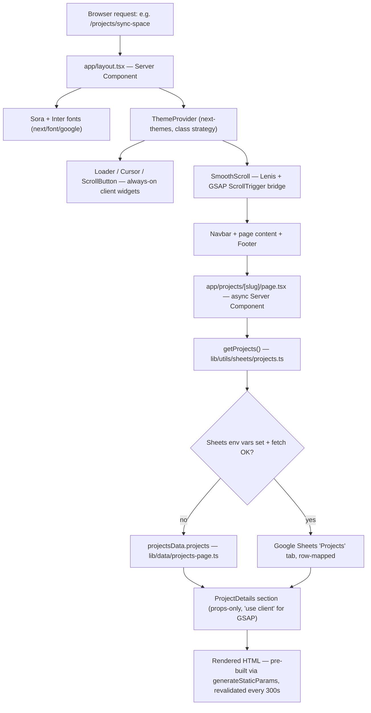

# Brain Stack — Project Overview

**Purpose of this document:** onboard a new developer to the codebase in one read. For scores, audits, and roadmap items, see [`architecture-audit.md`](./architecture-audit.md) and [`final-engineering-report.md`](./final-engineering-report.md).

> **Updated 2026-07-18:** this document's folder map and "dead file" references were refreshed after a full code-quality pass removed 17 confirmed-dead files (empty stubs, unused components, one unused hook — see [`folder-structure.md`](./folder-structure.md) §8 for the full list). SEO metadata wiring (mentioned as "in progress" in an earlier version of this doc) is also done — see [`seo-strategy.md`](./seo-strategy.md).

---

## What this is

Brain Stack is a Next.js (App Router) marketing/agency site: 7 routes, content sourced from Google Sheets with typed local fallbacks, GSAP-driven scroll animations, and a React Three Fiber decorative visualization on the About page.

## Request-to-pixels flow



**Step by step:**

1. **`app/layout.tsx`** (Server Component) is the one place fonts, theme, and the always-on decorative widgets (`Loader`, `Cursor`, `ScrollButton`, `SmoothScroll`) are wired. `MobileNav` renders outside `SmoothScroll` deliberately, so it stays `position: fixed` and unaffected by Lenis's transform-based scroll.
2. **`SmoothScroll`** instantiates Lenis, bridges its `scroll` event to `ScrollTrigger.update`, and drives both off `gsap.ticker` — bailing out entirely under `prefers-reduced-motion`.
3. **Every `page.tsx`** is an `async` Server Component. It calls one or more `get*Data()` functions from `lib/utils/sheets/*`, then passes plain data down as props — there is no client-side data fetching anywhere on the happy path.
4. **Section components** are `"use client"` because they need `useGSAP`/`useFrame`, but they only ever receive pre-fetched data as props. Server Components own data; Client Components own interaction/animation. This split is 100% consistent across all 24 sections.
5. **`export const revalidate = 300`** on every data-driven page makes every route ISR with a 5-minute cache — Sheet edits appear within 5 minutes without a redeploy.

## Folder map

Full detail (with an assessment of each folder) in [`folder-structure.md`](./folder-structure.md); summary:

```
app/                    Routes only — composes sections, no business logic
  about/, blog/[slug]/, blog/, contact/, projects/[slug]/, projects/, services/
  layout.tsx  page.tsx  loading.tsx  error.tsx  not-found.tsx  globals.css  sitemap.ts  robots.ts

components/
  sections/             24 files — one per page section, not reused cross-route
  layout/                Navbar, Footer, MobileNav, SmoothScroll, SettingsDrawer
  buttons/  cards/       Small reusable primitives (cards/ currently empty, scaffolding)
  common/                Logo, ThemeToggle, SectionBadge, ColorPaletteSwitcher, ScrollButton
  animations/            Cursor, Loader, MagneticButton, ParallaxImage, DiagonalPattern
  shared/                marquee.tsx
  three/                 BrainWireframe (React Three Fiber, dynamically imported — see performance-guide.md)
  theme/  ui/            next-themes wrapper; shadcn primitives (button, carousel, drawer)

hooks/                  Currently empty (.gitkeep) — scaffolding for the next custom hook

lib/
  data/                  Typed seed/fallback content, one file per page + shared-types.ts
  utils/sheets/          Google Sheets fetch + parse layer, mirrors lib/data/ 1:1, retry-on-failure
  actions/               contact.ts — the one Server Action in the app
  animations/            gsap-animations.ts + lenis.ts
  constants/             navigation, footer, contact, color-palettes
  metadata.ts            SEO metadata — fully wired, see seo-strategy.md
  utils/cn.ts  utils/icons.ts  utils/format-date.ts  utils/reading-time.ts  utils/image-placeholder.ts

scripts/                CSV export + one-time Sheets schema migration (dev-time only)
public/images/          blog/  projects/  project-thumbnails/  services/  team/  testimonials/
docs/                   This documentation set
```

## The "add a new page" pattern

This is the pattern every one of the 7 routes follows, mechanically, with zero exceptions:

1. Define the page's data shape(s) in `lib/data/<page>.ts` — typed seed data + exported `type X = typeof xData`.
2. Add a matching fetcher in `lib/utils/sheets/<page>.ts` — read the Sheet tab, parse each section with `parseJson`/`parseJsonObject` from `lib/utils/sheets/shared.ts`, fall back to step 1's seed data on any failure.
3. Create `app/<page>/page.tsx` as an `async` Server Component: call the fetcher(s), pass the result into section components as props.
4. Build section components in `components/sections/` — `"use client"`, typed against the `lib/data` interfaces, animated with the shared `gsap.effects.*` helpers from `lib/animations/gsap-animations.ts`.
5. Set `export const revalidate = 300` on the page.

Follow this exact sequence for any new page — see [`data-architecture.md`](./data-architecture.md) for the Sheets-side details and [`coding-guidelines.md`](./coding-guidelines.md) for naming conventions to use in step 1.

## Where to look for what

| Question | Look here |
|---|---|
| "Why does this page show stale content?" | `revalidate = 300` on the page — ISR window, not a bug |
| "Where does X page's copy come from?" | `lib/data/<page>.ts` (fallback) or the Google Sheet tab named after the page (live) |
| "How do I add a scroll-reveal animation?" | `gsap.effects.fadeUp`/`fadeUpOnScroll`/`staggerFadeUpOnScroll`/`textRevealOnScroll` in `lib/animations/gsap-animations.ts` — don't write a new tween from scratch |
| "Where's the component guidance?" | [`component-guidelines.md`](./component-guidelines.md) — where a new component goes, the standard section template, when (not) to extract a shared component |
| "How do SEO tags get set?" | `generateMetadata`/`metadata` exported from every route, sourced from `lib/metadata.ts` — see `seo-strategy.md` |
| "What's left to do?" | [`roadmap.md`](./roadmap.md) — prioritized, most items closed as of the latest engineering pass |
