# Brain Stack — Priority Roadmap (P1–P4)

See [`architecture-audit.md` §17](./architecture-audit.md#17-priority-roadmap-p1p4) for the summarized version referenced from the main report. This document is the standalone, fuller version with reasoning per item.

**Estimate basis:** difficulty and time assume one mid-to-senior engineer already familiar with this codebase (post-onboarding via `project-overview.md`). Double time estimates for a first-time contributor.

---

## P1 — Critical (blocks production sign-off)

### 1. Wire per-page `generateMetadata`
- **Difficulty:** Low
- **Impact:** Very High
- **Est. time:** 0.5–1 day
- **Status:** ✅ **Done 2026-07-18.** All 7 routes now export real metadata; `services`/`projects`/`contact` entries added to `pageMetadata`; a new `generateProjectMetadata` function added for `/projects/[slug]`. Verified in production build output — every page has a distinct title/description/canonical/OG image. A title-template double-branding bug found during verification was also fixed (`title: { absolute: ... }`).
- **Why it matters:** every route previously served the home page's title/description/OG image to search engines and social previews. The generation functions already existed in `lib/metadata.ts` — this was integration work, not design work.
- **Reference:** [`seo-strategy.md`](./seo-strategy.md)

### 2. Build the contact form backend
- **Difficulty:** Medium
- **Impact:** Very High
- **Est. time:** 1–2 days
- **Status:** 🟡 **Partially done 2026-07-18.** A Server Action (`lib/actions/contact.ts`) now handles submission with server-side validation (name/email/message) and honeypot spam protection; `ContactForm.tsx` uses `useActionState` for pending/success/error UI, with inline field errors and `aria-pressed` added to the service/budget toggle buttons. Verified end-to-end with Playwright: empty-submit validation, toggle state, successful submit with UI reset. **Delivery is still a TODO** — no email/storage provider has been chosen, so validated submissions are logged server-side, not sent anywhere. Revisit once a provider (Resend / SMTP / Sheets "Leads" tab) is decided.
- **Why it matters:** this is the site's literal conversion mechanism, and it previously did not submit anywhere.
- **Reference:** [`architecture-audit.md` §1](./architecture-audit.md)

### 3. Add `app/sitemap.ts` + `app/robots.ts`
- **Difficulty:** Low
- **Impact:** High
- **Est. time:** 0.5 day
- **Status:** ✅ **Done 2026-07-18.** Both files added; sitemap includes all static routes plus every project/blog slug; confirmed in build output (`○ /sitemap.xml`, `○ /robots.txt`).
- **Why it matters:** without a sitemap, dynamic routes (blog posts, project case studies) rely entirely on crawler discovery via internal links — a sitemap makes discovery deterministic and immediate.
- **Reference:** [`seo-strategy.md`](./seo-strategy.md)

---

## P2 — High Priority

### 4. Render existing JSON-LD structured data
- **Difficulty:** Low
- **Impact:** Medium-High
- **Est. time:** 0.5 day
- **Why it matters:** rich search results (article cards, organization knowledge panels) require structured data that's already written and simply not output as a `<script>` tag.

### 5. `next/dynamic` the `BrainWireframe` import
- **Difficulty:** Low
- **Impact:** Medium
- **Est. time:** 1–2 hours
- **Why it matters:** removes `three`/React Three Fiber from the About page's server-rendered JS payload with zero UX change — the canvas is `aria-hidden` and interaction-only.

### 6. Delete/repurpose dead files
- **Difficulty:** Low
- **Impact:** Medium (developer experience)
- **Est. time:** 2–3 hours
- **Status:** 🟡 **Partially done 2026-07-18** — the dead `seoMetadata`/`structuredDataScript` block was removed from `lib/metadata.ts` while wiring per-page metadata (item 1 above), since it was directly in the way and pointed at the wrong domain. The six empty files and the unused `useScrollReveal` hook are still present.
- **Why it matters:** six empty files, one unused hook, and a chunk of dead exports in `lib/metadata.ts` cost every new developer time figuring out whether they're actually unused or whether they're missing something.

### 7. Add root `app/error.tsx`
- **Difficulty:** Low
- **Impact:** Medium
- **Est. time:** 2–3 hours
- **Why it matters:** currently an unexpected server-side exception (not a 404) falls through to Next's default, unbranded error page. A thin branded wrapper, styled consistently with the existing `not-found.tsx`, closes this gap.

---

## P3 — Recommended

### 8. Adopt the shared type system (`ProcessStep`, `FeatureCard`, `ServiceOffering`, `SectionHeader`, `FAQItem`)
- **Difficulty:** Medium
- **Impact:** High (long-term developer experience and scalability)
- **Est. time:** 2–3 days including migrating the five existing `lib/data/*.ts` files
- **Why it matters:** this is the fix for the data-shape inconsistencies documented in `data-architecture.md` — three incompatible "process/steps" shapes, three incompatible "services" shapes, and a "features" grab-bag. Doing this before the team grows prevents each new developer from inventing a fourth variant of each.
- **Reference:** [`data-architecture.md` §5](./data-architecture.md)

### 9. Split `Project` into `ProjectSummary`/`ProjectCaseStudy`
- **Difficulty:** Medium
- **Impact:** Medium-High
- **Est. time:** 1 day
- **Why it matters:** makes the existing "thin project vs. full case study" distinction — which already exists in the data — an explicit, typed state instead of an accident of all-optional fields.
- **Reference:** [`data-architecture.md` §6](./data-architecture.md)

### 10. Bound `generateStaticParams` to recent-N for both dynamic routes
- **Difficulty:** Low
- **Impact:** Medium (scale-readiness)
- **Est. time:** 2–3 hours
- **Why it matters:** prevents build time from scaling linearly with project/post count as content grows into the hundreds; `dynamicParams` (default `true`) handles the long tail on first request.

### 11. Extract a shared `<ContactMethods />` component
- **Difficulty:** Low
- **Impact:** Low-Medium
- **Est. time:** 2–3 hours
- **Why it matters:** the email/phone/address/socials block is currently hand-copied in `Footer`, `ContactForm`, and `SettingsDrawer` — three places that will drift out of sync the first time someone updates one but not the others.

---

## P4 — Future / Nice to Have

### 12. Reorganize `components/sections/` into per-page subfolders
- **Difficulty:** Low
- **Impact:** Low now, High once triggered
- **Est. time:** 2–3 hours whenever the folder passes ~40 files
- **Why it matters:** at 27 files it's still navigable; past ~40 a flat structure stops being skimmable for a new developer.

### 13. Add a `ts-prune`/unused-export CI check
- **Difficulty:** Low
- **Impact:** Medium (prevents recurrence of items 6/8's root cause)
- **Est. time:** 2–3 hours
- **Why it matters:** every dead file found in this audit was found by manual reading. Automated tooling catches this continuously instead of requiring another full audit.

### 14. `poster` attribute + lighter mobile source for the hero video
- **Difficulty:** Low
- **Impact:** Low-Medium
- **Est. time:** 1–2 hours

### 15. `aria-pressed` on `ContactForm`'s toggle buttons
- **Difficulty:** Low
- **Impact:** Low
- **Est. time:** 30 minutes
- **Status:** ✅ **Done 2026-07-18** — added while rebuilding the form's Server Action; verified via Playwright.

### 16. Blur placeholders + `priority` on above-the-fold images
- **Difficulty:** Low
- **Impact:** Low-Medium
- **Est. time:** 2–3 hours

### 17. Revisit `AboutSection.tsx`'s manual `ScrollTrigger.getAll().kill()`
- **Difficulty:** Low
- **Impact:** Low (latent risk, not an active bug)
- **Est. time:** 1 hour
- **Why it matters:** risks killing sibling sections' ScrollTriggers under fast client-side navigation; `@gsap/react`'s scoped auto-cleanup already handles this correctly everywhere else in the codebase.

---

## Suggested sequencing

```mermaid
gantt
    title Suggested Roadmap Sequencing
    dateFormat X
    axisFormat %s
    section P1 (before launch)
    Wire per-page metadata       :p1a, 0, 1d
    Sitemap + robots             :p1b, 0, 1d
    Contact form backend         :p1c, 0, 2d
    section P2 (launch week)
    JSON-LD render                :p2a, after p1a, 1d
    Dynamic-import BrainWireframe :p2b, after p1c, 1d
    Dead code cleanup             :p2c, after p1c, 1d
    Root error.tsx                :p2d, after p1c, 1d
    section P3 (before major content growth)
    Shared type system            :p3a, after p2a, 3d
    Project type split            :p3b, after p3a, 1d
    Bound generateStaticParams    :p3c, after p3b, 1d
    ContactMethods extraction     :p3d, after p2c, 1d
```

This sequencing prioritizes the three P1 items in parallel (they don't depend on each other), followed by the quick P2 wins, with P3's data-model work scheduled deliberately *before* any large content import — doing it after would mean migrating hundreds of rows twice.
